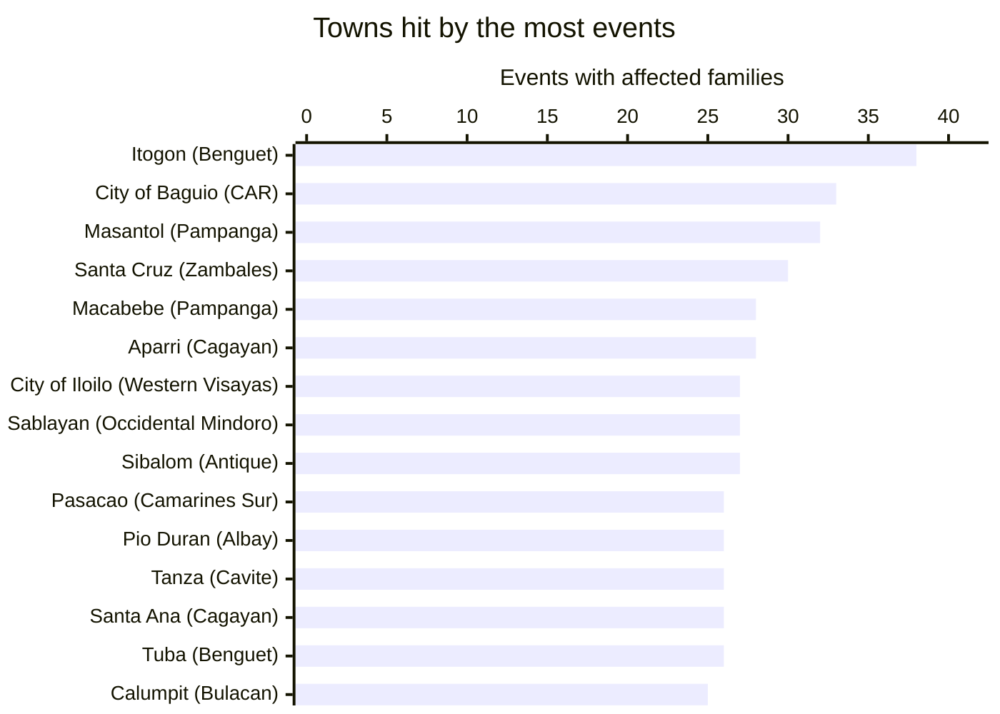
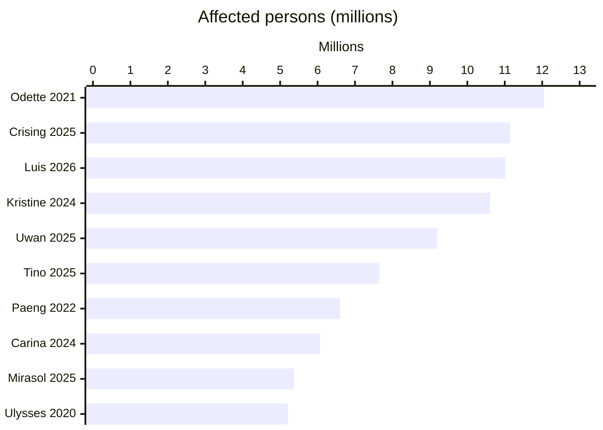
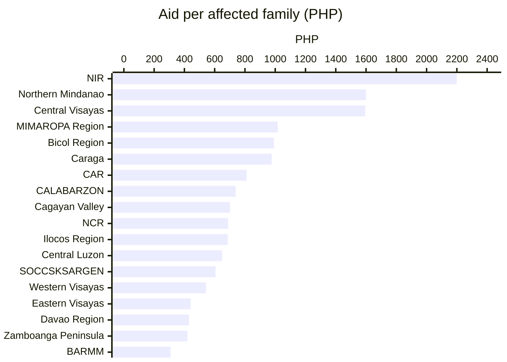
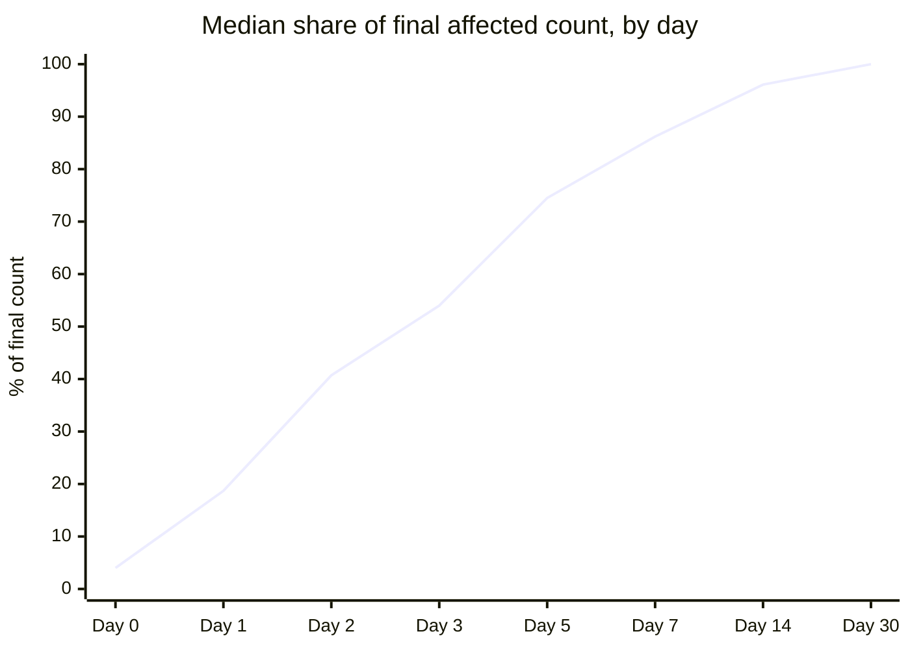

# Insights: Philippine typhoon impacts since 2017

Six questions answered from the gold tables: 128 events, 2017–2026, 17,542 event × town rows. All numbers are DSWD's own counts as reported in DROMIC situation reports; sakuna does not correct them. Read the [known gaps](known_gaps.md) first. Regenerate this page with `uv run python docs/research_scripts/insights.py`.

Words used below: *affected* = people DSWD counted as affected; *displaced* = people who stayed inside or outside evacuation centres (ECs), counted once over the whole event; *houses* = totally plus partially damaged.

## 1. Which towns are hit most often, and hardest?

1,531 of the country's 1,642 towns and cities had at least one affected family in at least one event. The most often hit are in the Cordillera (landslides and monsoon rain around Baguio), the Pampanga river delta (Masantol, Macabebe: flooded almost every monsoon season) and the northern tip of Luzon (Cagayan).

Hardest hit, by affected persons added up over all events (a person hit by three events is counted three times):

| Town | Province | Events | Affected persons, all events |
|---|---|---|---|
| Calumpit | Bulacan | 25 | 2,509,924 |
| City of Dagupan | Pangasinan | 24 | 1,877,994 |
| Macabebe | Pampanga | 28 | 1,682,869 |
| Hagonoy | Bulacan | 17 | 1,641,596 |
| Masantol | Pampanga | 32 | 1,634,396 |
| City of Bacoor | Cavite | 15 | 1,442,540 |
| City of Marikina | NCR | 18 | 1,275,004 |
| City of Biñan | Laguna | 16 | 1,091,575 |
| City of Cebu | Central Visayas | 14 | 1,033,024 |
| City of Meycauayan | Bulacan | 18 | 942,006 |

## 2. Storms ranked by human impact

Odette 2021 leads on all three measures. 7 of the ten events with the most affected people happened in 2024 or later. Several of the biggest are combined events (a storm plus the southwest monsoon, e.g. Crising 2025, Luis 2026): DSWD reports them as one.

| Rank | Most displaced | Persons | Most houses damaged | Houses |
|---|---|---|---|---|
| 1 | Odette 2021 | 3,896,753 | Odette 2021 | 2,143,100 |
| 2 | Uwan 2025 | 3,627,236 | Tino 2025 | 789,119 |
| 3 | Tino 2025 | 3,195,080 | Tisoy 2019 | 666,854 |
| 4 | Paeng 2022 | 3,030,198 | Ursula 2019 | 591,942 |
| 5 | Kristine 2024 | 2,944,696 | Uwan 2025 | 494,579 |
| 6 | Nika 2024 | 2,358,340 | Rolly 2020 | 398,266 |
| 7 | Mirasol 2025 | 1,877,107 | Ompong 2018 | 320,742 |
| 8 | Tisoy 2019 | 1,834,090 | Kristine 2024 | 277,613 |
| 9 | Ompong 2018 | 1,569,391 | Mirasol 2025 | 180,825 |
| 10 | Ulysses 2020 | 1,559,917 | Ulysses 2020 | 179,682 |

## 3. How long until evacuation centres empty?

Counted over the 74 events with at least five reports and at least 1,000 people inside ECs at the peak, measured from the event's start date and using DSWD's *now* column (people still inside on the report date). Reports come out daily at first, then weekly or less, so days are upper bounds.

- **Most people go home within days.** In half of these events, the number inside ECs fell below 10% of its peak by day 10 (70 of 74 events reached 10% in the reports).
- **The last families stay for months.** 38 of 74 events never show zero in any report: DSWD stopped reporting while some ECs were still open. Odette 2021 still had 582 people in 4 ECs in May 2023, 17 months after landfall.

| Event | Peak inside ECs | Peak on day | Below 10% by day | Zero by day | Last report day |
|---|---|---|---|---|---|
| Uwan 2025 | 1,118,544 | 2 | 9 | 209 | 290 |
| Odette 2021 | 478,019 | 6 | 64 | 1542 | 1542 |
| Nika 2024 | 472,872 | 8 | 17 | never | 150 |
| Tino 2025 | 469,447 | 2 | 19 | never | 336 |
| Kristine 2024 | 365,024 | 6 | 33 | 241 | 412 |
| Ulysses 2020 | 324,363 | 7 | 33 | never | 370 |
| Paeng 2022 | 297,341 | 7 | 21 | never | 324 |
| Tisoy 2019 | 296,668 | 5 | 24 | never | 377 |
| Rolly 2020 | 269,507 | 5 | 21 | never | 158 |
| Agaton 2022 | 227,459 | 11 | 24 | never | 150 |
| Carina 2024 | 204,446 | 4 | 10 | never | 66 |
| Crising 2025 | 198,052 | 8 | 29 | never | 162 |

## 4. Aid per affected family, by region

Total cost of assistance (DSWD, local governments, NGOs and others) divided by affected families, from each region's row in each event's latest report, so aid given to provinces rather than towns is included. All events added up; pesos are not adjusted for inflation.

Next to poverty: PSA's poverty incidence among families (share of families below the poverty line), 2023 and 2025, from `1_2025 Full Year Official Poverty Statistics_30Oct2026_rev.xlsx` (PSA, table 1). Regions are sorted poorest first.

| Region | Aid per affected family (PHP) | Poor families 2023 | 2025 |
|---|---|---|---|
| BARMM | 308 | 26.0% | 12.8% |
| NIR | 2,199 | 22.6% | 14.3% |
| Zamboanga Peninsula | 420 | 22.5% | 9.8% |
| Bicol Region | 991 | 20.3% | 16.8% |
| Eastern Visayas | 441 | 20.3% | 12.8% |
| Northern Mindanao | 1,600 | 18.4% | 14.4% |
| SOCCSKSARGEN | 606 | 17.0% | 9.6% |
| MIMAROPA Region | 1,017 | 16.3% | 11.3% |
| Caraga | 976 | 14.9% | 7.8% |
| Central Visayas | 1,595 | 12.3% | 8.7% |
| Davao Region | 430 | 11.3% | 5.5% |
| Western Visayas | 543 | 9.8% | 5.2% |
| Ilocos Region | 687 | 8.4% | 4.0% |
| Cagayan Valley | 701 | 7.2% | 4.4% |
| Central Luzon | 649 | 5.7% | 1.9% |
| CALABARZON | 738 | 5.3% | 2.7% |
| CAR | 811 | 4.4% | 2.7% |
| NCR | 689 | 1.1% | 0.6% |

Aid per family does not follow poverty (rank correlation -0.05 across 18 regions; 0 = no relation, +1 = the poorest regions always get the most). The four poorest regions in 2023 (BARMM, NIR, Zamboanga Peninsula, Bicol Region) are spread across the aid ranking. Aid depends on many things this table does not show: storm strength, how long people stayed in ECs, prices and when the event happened. Treat this as a description, not a judgement.

## 5. What share of a town's people is affected?

Affected persons divided by the town's 2024 census population (PSA, in the PSGC file), for the 17,292 event × town rows with a population and at least one affected person. In a typical row 3% of the town is affected.

| Share of population affected | Event × town rows | Share of rows |
|---|---|---|
| under 10% | 11,289 | 65% |
| 10–50% | 3,572 | 21% |
| 50–100% | 1,290 | 7% |
| over 100% | 1,141 | 7% |

**1,141 rows count more affected people than the town's population.** These are DSWD's numbers, not a matching error (Mariveles, Bataan, 2023: 335,487 affected, 156,200 residents, the same figure in each of its last five reports). Possible causes: people from nearby towns counted where they took shelter, families multiplied by an assumed household size, or older population figures in the field. Treat shares above 100% as "most or all of the town".

Towns where at least half the population was affected most often (rows over 100% left out):

| Town | Province | Events with 50–100% affected |
|---|---|---|
| Macabebe | Pampanga | 10 |
| Calumpit | Bulacan | 9 |
| City of Dagupan | Pangasinan | 9 |
| Tineg | Abra | 9 |
| Minalin | Pampanga | 8 |
| San Miguel | Catanduanes | 8 |
| San Simon | Pampanga | 8 |
| Sigma | Capiz | 8 |
| Cabusao | Camarines Sur | 7 |
| Caramoan | Camarines Sur | 7 |

## 6. How much do day-1 reports undercount?

For the 117 events with at least 1,000 affected persons in the final count, the line shows the median share of the final affected-persons count that DSWD's own national total had reached N days after the first report. The first report shows a median **4%** of the final number; it takes about 3 days to reach half. The latest report comes a median 65 days after the first.

Early reports are a floor, not an estimate: anyone using a first-week report (for news, funding or models) should expect the final count to be many times larger.

---
Source: DSWD DROMIC situation reports. Cleaned by sakuna. Not an official DSWD product.
Population (2024 census) and poverty statistics: Philippine Statistics Authority (PSA).
